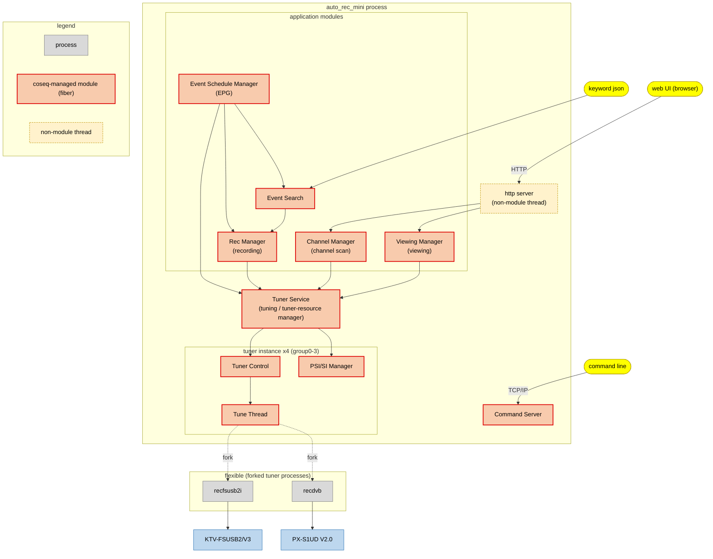
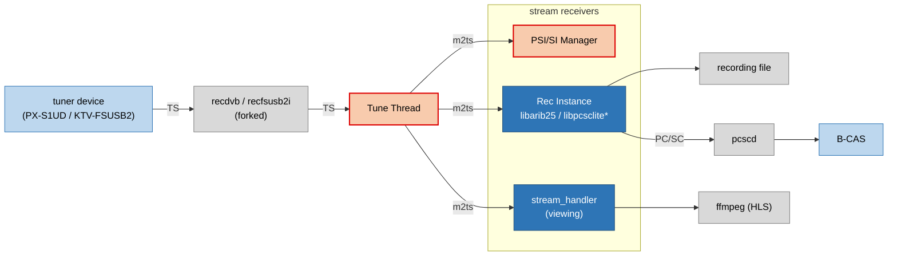

[Japanese](/README_ja.md)

auto_rec_mini
===============

Digital broadcast recording system for Japan. This middleware is a tiny and minimal implementation.  
Recording, EPG acquisition, keyword search recording reservation are the main functions.  
(+ Real-time viewing function (in browser by HLS).)  
Simple to build and use.  
  
For self studying MPEG-2 TS and ARIB.  

<!--

-->

Features
-------------
* Tuning
  * Terrestrial digital only.
  * Simultaneous selection by multiple tuners.
* Channel scan
* Record and schedule recording
  * Simultaneous recording with multiple tuners.
  * Event tracking.
  * After obtaining the EPG, search for the registered keyword and schedule recording.
  * Introduced tssplitter_lite.
* EPG
  * Perform scheduled EPG acquisition.
* Viewing (*Platform dependent)
  * View broadcasts in real time on your browser using ffmpeg HLS.
  * Simultaneous viewing with multiple tuners.
  * Introduced tssplitter_lite.
* Broadcaster logo download
  * Save what fell during song selection in PNG format.
  * Since palette information (CLUT common fixed color) is added, it can be viewed as it is. (It should be possible.)
* Command Line Interface (CLI)
  * Connect to the `command server` with `telnet` or `netcat`, etc., and execute commands that access each function.

Architecture
------------
<!--

-->

> **Tuner Service** sits at the center of this diagram. It looks after the tuner groups (0-3) and their allocation, and modules that need tuning go through it.

> The Command Server accepts CLI connections (`command line`) and sends operation / debug commands to **every module**. The per-module edges are omitted here to keep the diagram readable — see [How to use CLI](#how-to-use-cli) for the full command set.

**Stream (m2ts) data flow**

> The m2ts stream from **Tune Thread** is delivered to the three components that receive it — **PSI/SI Manager**, **Rec Instance**, and **stream_handler** (viewing).

Future tasks
------------
* BS/CS compatible.
* BML-related functions for data broadcasting. (Implementation of dsmcc)
* Expand the HTTP API (add more endpoints).

System requirements
----------

### Tuners ###
The supported tuners are as follows. only terrestrial digitl.
* [`KTV-FSUSB2/V3`](http://www.keian.co.jp/products/ktv-fsusb2v3/#spec-table) (S/N: K1212 later)  
* [`PX-S1UD V2.0`](http://www.plex-net.co.jp/product/px-s1udv2/)

Anything that works with other PLEX tuners or `recdvb` should work.

### Platforms ###
Will work on generic linux destributions. (confirmed worked on `Ubuntu`, `Fedora`, `Raspberry Pi OS`)  
  
I usually use `Raspberry Pi3 model B` to check the operation,  
If the back EPG acquisition runs during recording, or if multiple simultaneous recordings are performed,  
packet loss may occur, causing block noise and image skipping..  
~~There was a case that ts could not be taken because of insufficient power at the start of tuning.~~  
As a remedy, using a 5V4A power adapter has improved somewhat.
These will also be improved on Pi4.
  
Regarding the viewing function, we use ffmpeg to encode in H.264 and view it in a browser using the HLS streaming method.  
H.264 assumes HW encoding on Raspberry Pi4 (h264_omx), but encoding could not keep up with the playback speed on Pi3.  
It also depends on the version of ffmpeg, and operation has been confirmed with versions below 4.1.  
(For versions 4.2 and above, an error will occur due to the subtitle stream.)  
(On Raspberry Pi OS, when using Buster, ffmpeg 4.1 series is installed by default.)  
  
Also using B-CAS card with IC card reader.

### Dependencies ###
Depends on the following libraries.  
Please install as appropriate.  
  
*libpcsclite*

	$ sudo apt-get install pcscd libpcsclite-dev libccid pcsc-tools

*libarib25*

	$ sudo apt-get install cmake g++
	$ git clone https://github.com/stz2012/libarib25.git
	$ cd libarib25
	$ mkdir build
	$ cd build
	$ cmake ..
	$ make
	$ sudo make install

*Install firmware for PLEX tuners. (isdbt_rio.inp)*

	$ wget http://plex-net.co.jp/plex/px-s1ud/PX-S1UD_driver_Ver.1.0.1.zip
	$ unzip PX-S1UD_driver_Ver.1.0.1.zip
	$ sudo cp PX-S1UD_driver_Ver.1.0.1/x64/amd64/isdbt_rio.inp /lib/firmware/
	$ sync
	$ sudo reboot

Build and install
------------
### Build and install ###
The code depends on several git submodules.  
You need cloned the repository with --recursive.

	$ git clone --recursive https://github.com/ysan/auto_rec_mini.git
	$ cd auto_rec_mini
	$ make
	$ sudo make INSTALLDIR=/opt/auto_rec_mini install

Installation files:

	/opt/auto_rec_mini/
	├── bin
	│   ├── auto_rec_mini
	│   ├── recfsusb2i
	│   └── recdvb
	└── lib
	    ├── libchannel_manager.so
	    ├── libcommand_server.so
	    ├── libcommon.so
	    ├── libdsmccparser.so
	    ├── libevent_schedule_manager.so
	    ├── libevent_search.so
	    ├── libparser.so
	    ├── libpsisi_manager.so
	    ├── libpsisiparser.so
	    ├── librec_manager.so
	    ├── libstream_handler.so
	    ├── libcoseq.so
	    ├── libcoseqpp.so
	    ├── libtuner_control.so
	    ├── libtuner_service.so
	    ├── libtune_thread.so
	    └── libviewing_manager.so

### Running as a Linux service (use systemd) ###
Copy the configuration file(`settings.json`) to /opt/auto_rec_mini/ .

	$ sudo cp settings.json /opt/auto_rec_mini

Copy the systemd unit file. (`auto_rec_mini.service`)

	$ sudo cp auto_rec_mini.service /etc/systemd/system

To start the service for the first time, do the usual systemctl dance.

	$ sudo systemctl daemon-reload
	$ sudo systemctl enable auto_rec_mini.service
	$ sudo systemctl start auto_rec_mini.service

`auto_rec_mini` process is up and ready to use the tuner.  
`command server` is listening for connections on port 20001.  
First, please execute the `channel scan` CLI command.  

### Syslog configuration and rotation ###
Copy the syslog configuration file. (`30-auto_rec_mini.conf`) and restart syslog service.  
If you set `is_syslog_output` to `true` in `settings.json`,  
you can output to `/var/log/auto_rec_mini/auto_rec_mini.log`.

	$ sudo cp 30-auto_rec_mini.conf /etc/rsyslog.d
	$ sudo systemctl restart rsyslog.service

Copy the rotation configuration file. (`logrotate-auto_rec_mini`)  

	$ sudo cp logrotate-auto_rec_mini /etc/logrotate.d
	$ sudo chown root:root /etc/logrotate.d/logrotate-auto_rec_mini

### Uninstall ###
	$ sudo systemctl stop auto_rec_mini.service
	$ sudo systemctl disable auto_rec_mini.service
	$ sudo rm /etc/systemd/system/auto_rec_mini.service
	$ sudo systemctl daemon-reload
	$ sudo rm /etc/rsyslog.d/30-auto_rec_mini.conf
	$ sudo rm /etc/logrotate.d/logrotate-auto_rec_mini
	$ sudo systemctl restart rsyslog.service
	$ sudo make INSTALLDIR=/opt/auto_rec_mini clean
	$ make clean

settings.json
------------

`settings.json` is a configuration file.  
Read at `auto_rec_mini` process startup.  
There are no default values, and settings are made by reading this file.  
Please you set according to the environment.

| items | descriptions |
|:------|:-------------|
| `is_syslog_output` | Switch whether to output log to `syslog`. |
| `command_server_port` | Listening port of `command server`. |
| `tuner_hal_allocates` | Assign the tuner hal command. |
| `channels_json_path` | Save/load destination of channel scan result. |
| `rec_reserves_json_path` | Save/load destination of recording reservation. |
| `rec_results_json_path` | Save/load destination of recording result. |
| `rec_ts_path` | Save destination of recording stream. |
| `rec_disk_space_low_limit_MB` | Threshold of the remaining capacity of the file system for recording. (MBytes) |
| `rec_use_splitter` | Toggles whether to apply tssplitter_lite to the recording stream. |
| `dummy_tuner_ts_path` | unused |
| `event_schedule_cache_is_enable` | Switch to enable EPG. |
| `event_schedule_cache_start_interval_day` | EPG cache execution interval date. |
| `event_schedule_cache_start_time` | EPG cache start time. (HH:mm) |
| `event_schedule_cache_timeout_min` | EPG cache timeout minute. |
| `event_schedule_cache_retry_interval_min` | EPG cache retry interval minute. |
| `event_schedule_cache_data_json_path` | Save/load EPG cached json data. |
| `event_schedule_cache_histories_json_path` | Save/load destination of EPG cache history. |
| `event_name_keywords_json_path` | Save/load destination of keywords for `event name` search. |
| `extended_event_keywords_json_path` | Save/load destination of keywords for `extended event` search. |
| `event_name_search_histories_json_path` | Save/load destination of `event name` search history. |
| `extended_event_search_histories_json_path` | Save/load destination of `extended event` search history. |
| `viewing_stream_command_format` | Write the viewing stream command. |
| `viewing_stream_data_path` | Path to write/read the viewing stream file. |
| `viewing_use_splitter` | Toggle whether to apply tssplitter_lite to the viewing stream. |
| `http_server_port` | listening port of the HTTP server. |
| `http_server_static_contents_path` | Location where Web UI content is placed and corresponds to the document root. The Web UI (client) is provided by [auto_rec_mini_trials](https://github.com/ysan/auto_rec_mini_trials); build it there and place the output here. |
| `logo_path` | save/load destination of broadcaster logo png. |

### tuner_hal_allocates ###
Assign commands according to the tuner hardware you can use.

	"tuner_hal_allocates": [
		"./bin/recdvb %d - -",
		"./bin/recfsusb2i --np %d - -"
	],

### event_name_keywords_json_path ###

By creating json of the following format in `event_name_keywords_json_path`  
Search for programs whose keywords are included in the program name after EPG acquisition and  
make a recording reservation.  
No limit to the number of keywords.

	{
        "m_event_name_keywords": [
	        "ＸＸＸニュース",
	        "ＸＸＸスポーツ",
	        "ＸＸＸ報道"
	    ]
	}

### extended_event_keywords_json_path ###

By creating json of the following format in `extended_event_keywords_json_path`  
Search for programs whose keywords are included in the program name after EPG acquisition and  
make a recording reservation.  
No limit to the number of keywords.

	{
	    "m_extended_event_keywords": [
	        "ワールドカップ",
	        "オリンピック",
	        "野球"
	    ]
	}

### viewing_stream_command_format ###

As an initial value, we have included a command to encode in H264 using ffmpeg's HLS method.  

How to use CLI
------------

In addition to the HTTP API, `auto_rec_mini` provides an
interactive command shell over TCP, called the *command server*. It listens on the
port set by `command_server_port` in `settings.json` (default `20001`).

### Connect ###

Open another terminal and connect with `netcat` (or `telnet`):

	$ nc -C 127.0.0.1 20001

	###  command line  begin. ###

	  ------ root tables ------
	  s     -- system commands
	  tc    -- tuner control
	  pm    -- psisi manager
	  ts    -- tuner service
	  rec   -- rec manager
	  cm    -- channel manager
	  em    -- event schedule manager
	  es    -- event search
	  vm    -- viewing manager

	/ >

### Navigation ###

| input | action |
| --- | --- |
| `<key>` (e.g. `cm`) | enter a module sub-menu |
| `<command> [args ...]` | run a command in the current menu (args are space-separated) |
| `.` | re-print the current menu |
| `..` | go up one level (to the parent menu) |

Each command shows its `usage:` (arguments) in the menu listing. Log level and closing the connection are system commands under `s` (see the `s` table below); you can also disconnect with Ctrl-C.

### Quick start ###

	# 1) scan channels first (needed once)
	/ > cm
	/channel manager > scan

	# 2) live view, then stop
	/ > vm
	/viewing manager > ch 27 0        # ch {physical_channel} {service_idx}; prints the assigned group_id
	/viewing manager > stop 0         # stop {group_id} (the id printed by ch)

	# 3) record the current program of an already-tuned group
	/ > rec
	/rec manager > ce 0               # reserve the current event on group 0 (see note below)
	/rec manager > g                  # list reservations

**About `group_id`** — a `group_id` identifies a tuner group (0-3), owned and allocated by the **Tuner Service** (the hub all modules converge into in the [Architecture](#architecture) diagram). How you obtain one differs by use case:

- **Viewing** (`vm ch` / `vm svc`) allocates a tuner group automatically and prints the assigned `group_id`; use that id for `vm stop` / `vm opt`.
- **`rec ce {group_id}`** reserves the *current* event, so the group must already be tuned — e.g. a running live view, a channel scan, or `ts op` + `ts t`.
- **Scheduled reservations** (`rec e` / `eh` / `m`) do not need a pre-tuned group; a tuner is allocated automatically at recording time.

### Command reference ###

**`s` - system**

| command | description |
| --- | --- |
| `e` | echo from command server |
| `cl` | close connection |
| `lv {0-4}` | set log level (0:debug 1:info 2:warning 3:error 4:perror) |
| `ts` | status dump (no-op on coseq) |

**`tc` - tuner control**

| command | description |
| --- | --- |
| `t {freq[kHz]} {tuner_id}` | tune by frequency |
| `ch {physical_channel} {tuner_id}` | tune by physical channel |
| `stop {tuner_id}` | tune stop |
| `s` | get tuner state (printed to the CLI) |

**`ts` - tuner service**

| command | description |
| --- | --- |
| `op` | open tuner resource |
| `cl {tuner_id}` | close tuner resource |
| `t {physical_channel} {tuner_id}` | tune by physical channel |
| `stop {tuner_id}` | tune stop |
| `d` | dump tuner resources to the log |

**`pm` - psisi manager**

| command | description |
| --- | --- |
| `st {tuner_id}` | set target tuner id |
| `dp` | dump program infos to the log |
| `ds` | dump service infos to the log |
| `de` | dump event present/following infos to the log |
| `dn` | dump network info to the log |
| `t` | PSI/SI table dump sub-menu (see below) |

The `t` sub-menu dumps individual PSI/SI tables to the log:

| command | description |
| --- | --- |
| `pat` | dump PAT |
| `pmt` | dump PMT |
| `eit_pf` | dump EIT (p/f) |
| `eit_pf_s` | dump EIT (p/f) simple |
| `eit_sch` | dump EIT (schedule) |
| `eit_sched_e` | dump EIT (schedule) event |
| `eit_sched_s` | dump EIT (schedule) simple |
| `nit` | dump NIT |
| `sdt` | dump SDT |
| `cat` | dump CAT |
| `cdt` | dump CDT |
| `rst` | dump RST |
| `bit` | dump BIT |

**`rec` - rec manager**

| command | description |
| --- | --- |
| `ce {group_id}` | add reserve - current event |
| `e {tsid} {org_nid} {svcid} {evtid} {repeat}` | add reserve - event (repeat: 0 none, 1 auto) |
| `eh {index} {repeat}` | add reserve - event by index (helper) |
| `m {tsid} {org_nid} {svcid} {start} {end} {repeat}` | add reserve - manual (time `yyyyMMddHHmmss`; repeat 0 none, 1 daily, 2 weekly) |
| `r {tsid} {org_nid} {svcid} {evtid} {consider_repeat}` | remove reserve (consider_repeat: 0 false, 1 true) |
| `rx {index} {consider_repeat}` | remove reserve by index |
| `g` | get reserves (list printed to the CLI) |
| `stop {group_id}` | force stop recording |
| `dr` | dump reserves to the log |
| `drl` | dump recording results to the log |
| `drec` | dump currently-recording entries to the log |

**`cm` - channel manager**

| command | description |
| --- | --- |
| `scan` | channel scan |
| `t` | tune (interactive mode) |
| `stop {group_id}` | tune stop |
| `d` | dump channels to the log |

**`em` - event schedule manager (EPG)**

| command | description |
| --- | --- |
| `cs` | cache schedule (EPG) |
| `csc {group_id}` | cache schedule - force current service |
| `stop` | stop cache schedule |
| `dm` | dump schedule map to the log |
| `d {tsid} {org_nid} {svcid}` | dump schedule to the log |
| `di` | dump schedule to the log (interactive mode) |
| `ded {index}` | dump event detail to the log (from last dumped schedule) |
| `grep {keyword}` | search events by event name (results to the CLI) |
| `grepx {keyword}` | search events by event name + extended info (results to the CLI) |
| `dr` | dump reserves to the log |
| `h` | dump histories to the log |

**`es` - event search**

| command | description |
| --- | --- |
| `r` | add rec reserve (event-name keyword search) |
| `rx` | add rec reserve (extended-event keyword search) |
| `h` | dump histories to the log (event-name keyword) |
| `hx` | dump histories to the log (extended-event keyword) |

**`vm` - viewing manager**

| command | description |
| --- | --- |
| `ch {physical_channel} {service_idx}` | start viewing by physical channel |
| `svc {tsid} {org_nid} {svcid}` | start viewing by service id |
| `stop {group_id}` | force stop viewing |
| `opt {group_id} {auto_stop_grace_period_sec}` | set option |
| `d` | dump to the log |

### HTTP API ###

The HTTP API is the JSON interface used by the Web UI. The server listens on
`http_server_port` in `settings.json` (default `8080`); `POST` requests require the
header `Content-Type: application/json`.

| method | endpoint | description | request | response |
| --- | --- | --- | --- | --- |
| `POST` | `/api/ctrl/viewing/start_by_physical_channel` | start live viewing by physical channel number | body: `{ "physical_channel", "service_idx", "option"?: { "auto_stop_grace_period_sec" } }` | `{ "group_id" }` |
| `POST` | `/api/ctrl/viewing/start_by_service_id` | start live viewing by service (TS / network / service id) | body: `{ "transport_stream_id", "original_network_id", "service_id", "option"?: { "auto_stop_grace_period_sec" } }` | `{ "group_id" }` |
| `POST` | `/api/ctrl/viewing/stop` | stop live viewing for a group | body: `{ "group_id" }` | `200 OK` |
| `POST` | `/api/ctrl/viewing/auto_stop_grace_period` | set the auto-stop grace period (sec) for a group | body: `{ "group_id", "period_sec" }` | `200 OK` |
| `GET` | `/api/ctrl/channel/channels` | list all scanned channels | - | array of `{ "physical_channel", "transport_stream_id", "original_network_id", "service_ids": [ ... ] }` |
| `GET` | `/api/ctrl/channel/original_network_name/{onid}` | get the network name for an original_network_id | path: `onid` | `{ "original_network_name" }` |
| `GET` | `/api/ctrl/channel/transport_stream_name/{onid}/{tsid}` | get the transport stream name | path: `onid`, `tsid` | `{ "transport_stream_name" }` |
| `GET` | `/api/ctrl/channel/service_name/{tsid}/{onid}/{svcid}` | get the service (channel) name | path: `tsid`, `onid`, `svcid` | `{ "service_name" }` |
| `GET` | `/api/ctrl/psisi/{group_id}/present_event/{tsid}/{onid}/{svcid}` | get the present (now-playing) event of a service | path params | `{ "transport_stream_id", "original_network_id", "service_id", "event_id", "start_time", "end_time", "event_name_char" }` |
| `GET` | `/api/ctrl/psisi/{group_id}/follow_event/{tsid}/{onid}/{svcid}` | get the following (next) event of a service | path params | same fields as `present_event` |

Notes:
- `start_time` / `end_time` are UNIX epoch seconds.
- On error the server returns `400` (bad request / missing field) or `500` (internal error).
- The HTTP API is still being expanded; more endpoints will be added (TODO).

#### curl examples ####

	# start live view by physical channel
	curl -X POST -H "Content-Type: application/json" \
	  -d '{"physical_channel": 27, "service_idx": 0}' \
	  http://localhost:8080/api/ctrl/viewing/start_by_physical_channel

	# start live view by service id (with auto-stop option)
	curl -X POST -H "Content-Type: application/json" \
	  -d '{"transport_stream_id": 32736, "original_network_id": 32736, "service_id": 1024, "option": {"auto_stop_grace_period_sec": 10}}' \
	  http://localhost:8080/api/ctrl/viewing/start_by_service_id

	# stop viewing (group 0)
	curl -X POST -H "Content-Type: application/json" \
	  -d '{"group_id": 0}' \
	  http://localhost:8080/api/ctrl/viewing/stop

	# list scanned channels
	curl http://localhost:8080/api/ctrl/channel/channels

	# present event of a service
	curl http://localhost:8080/api/ctrl/psisi/0/present_event/32736/32736/1024

Others
------------
Using [`cpp-httplib`](https://github.com/yhirose/cpp-httplib) for the internal HTTP server.  
Using [`nlohmann/json`](https://github.com/nlohmann/json) for json SerDes.  
Setting value etc. Have static data by using [`cereal`](https://github.com/USCiLab/cereal) json SerDes. (no use DB.)  
Using the [`coseq`](https://github.com/ysan/coseq) fiber-based coroutine framework for concurrency.  
  
I have been influenced and referred to by the following repositories.
* [`libarib25`](https://github.com/stz2012/libarib25)
* [`epgdump`](https://github.com/Piro77/epgdump)
* [`ariblib`](https://github.com/youzaka/ariblib)
* [`eit_txtout_mod`](https://github.com/arairait/eit_txtout_mod)
* [`node-aribts`](https://github.com/rndomhack/node-aribts)
* [`TVRemotePlus`](https://github.com/tsukumijima/TVRemotePlus)
* [`KonomiTV`](https://github.com/tsukumijima/KonomiTV)
  
LICENSE
------------
MIT
