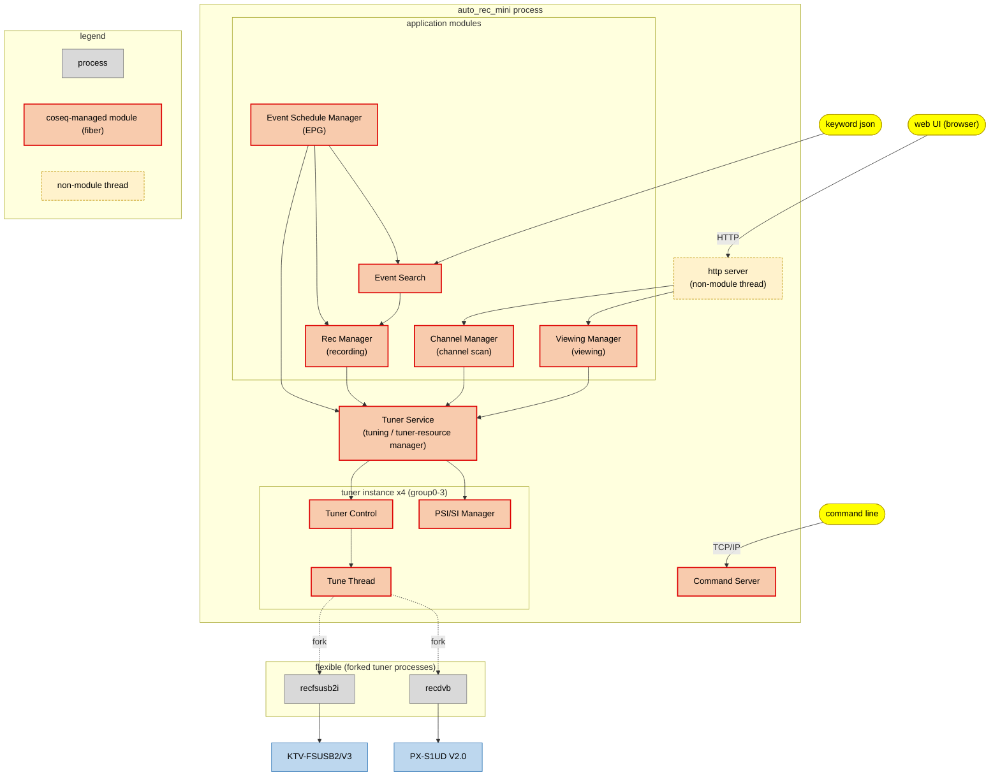
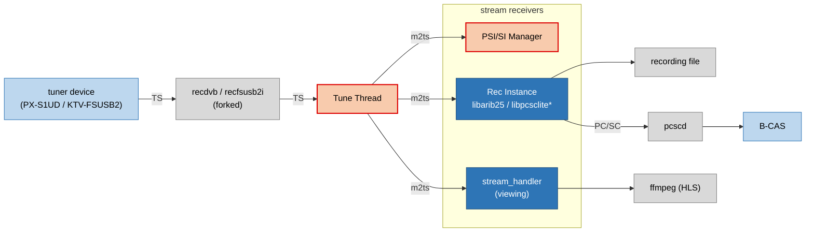

[English](https://github.com/ysan/auto_rec_mini/)

auto_rec_mini
===============

最小機能のTV録画ミドルウェア。  
録画、EPG取得、キーワード検索録画予約が主な機能です。  
（+ リアルタイム視聴機能（HLSによるブラウザ視聴）。）  
構築等をシンプルに。  
  
MPEG-2TSやARIBの勉強のため。  

<!--

-->

Features
------------ 
* 選局
  * 地デジのみ。
  * 複数チューナーによる同時選局。
* チャンネルスキャン
* 録画 及び 録画予約
  * 複数チューナーによる同時録画。
  * イベント追従。
  * EPG取得後に登録したキーワードを検索し録画予約を行います。
  * tssplitter_liteを導入。
* EPG
  * 定時EPG取得を行います。
* 視聴 (※プラットフォーム依存有り)
  * ffmpeg HLSによりブラウザで放送をリアルタイム視聴します。
  * 複数チューナーによる同時視聴。
  * tssplitter_liteを導入。
* 放送局ロゴダウンロード
  * 選曲中に降ってきたものをPNG形式で保存します。
  * パレット情報（CLUT共通固定色）を付加するのでそのまま閲覧できます。(できるはず、。)
* コマンドラインインターフェース (CLI)
  * `telnet`や`netcat`等で`command server`に接続して、各機能にアクセスするコマンドの実行等を行います。

Architecture
------------
<!--

-->

> **Tuner Service** がこの図の中心的な存在です。チューナーグループ (0-3) の確保・割り当てを受け持ち、選局が必要なモジュールはここを通してチューナーを使います。

> Command Server は CLI 接続 (`command line`) を受け、**全モジュール**へ操作 / デバッグコマンドを送ります。見やすさのため各モジュールへの線は図では省略しています。コマンド一覧は [How to use CLI](#how-to-use-cli) を参照してください。

**ストリーム (m2ts) データフロー**

> **Tune Thread** からの m2ts ストリームは、これを受信する3つのコンポーネント（**PSI/SI Manager** / **Rec Instance** / **stream_handler**（視聴））へ配信されます。

Future tasks
------------
* BS/CS対応。
* データ放送のBML関連機能。(dsmccの実装)
* HTTP API の拡充 (エンドポイント追加)。

System requirements
------------

### Tuners ###
対応しているチューナーは以下のものです。今のところ地デジのみとなります。
* [`KTV-FSUSB2/V3`](http://www.keian.co.jp/products/ktv-fsusb2v3/#spec-table) (S/N: K1212 以降)  
* [`PX-S1UD V2.0`](http://www.plex-net.co.jp/product/px-s1udv2/)

他のPLEX社製チューナーや`recdvb`で動くものであれば動作すると思われます。

### Platforms ###
一般的なLinuxであれば問題なく動作すると思います。(`Ubuntu`, `Fedora`, `Raspberry Pi OS`で確認済。)  
  
普段動作確認で使用しているのは`Raspberry Pi3 model B`ですが、  
録画中に裏EPG取得が走る場合や、複数同時録画している場合は、  
パケットロスが起こり、ブロックノイズ、画飛びが起きることがあります。。  
~~また選局開始時に電力が足りないせいかtsが取れないことがあります。~~  
改善策として5V4Aの電源アダプターを使用することでそれなりに改善が見られました。
またPi4でもこれらは改善されます。
  
視聴機能に関してはffmpegを使いH.264でエンコードしHLSのストリーム方式によりブラウザで視聴する方式をとっています。  
H.264はRaspberry Pi4でのHWエンコードを前提としています(h264_omx)、Pi3では再生の速度にエンコードが追いつきませんでした。  
またffmpegのバージョンにも依存あり4.1以下で動作確認できています。(4.2以上では字幕ストリームの関係でエラーとなってしまいます。)  
(Raspberry Pi OSにおいてはBusterを使用すると標準で4.1系のffmpegがインストールされています。)  
  
B-CASカードは別途USB接続のICカードリーダを用意して使用しています。

### Dependencies ###
下記のライブラリに依存します。  
適宜インストールをお願いします。  
  
*libpcsclite*

	$ sudo apt-get install pcscd libpcsclite-dev libccid pcsc-tools

*libarib25*

	$ sudo apt-get install cmake
	$ git clone https://github.com/stz2012/libarib25.git
	$ cd libarib25
	$ mkdir build
	$ cd build
	$ cmake ..
	$ make
	$ sudo make install

*PLEX社製チューナー向けファームウェアをインストールします。(isdbt_rio.inp)*

	$ wget http://plex-net.co.jp/plex/px-s1ud/PX-S1UD_driver_Ver.1.0.1.zip
	$ unzip PX-S1UD_driver_Ver.1.0.1.zip
	$ sudo cp PX-S1UD_driver_Ver.1.0.1/x64/amd64/isdbt_rio.inp /lib/firmware/
	$ sync
	$ sudo reboot

Build and install
------------
### Build and install ###
いくつかのサブモジュールに依存しています。  
--recursiveを使用してリポジトリのクローンを作成する必要があります。

	$ git clone --recursive https://github.com/ysan/auto_rec_mini.git
	$ cd auto_rec_mini
	$ make
	$ sudo make INSTALLDIR=/opt/auto_rec_mini install

Installation files:

	/opt/auto_rec_mini/
	├── bin
	│   ├── auto_rec_mini
	│   ├── recfsusb2i
	│   └── recdvb
	└── lib
	    ├── libchannel_manager.so
	    ├── libcommand_server.so
	    ├── libcommon.so
	    ├── libdsmccparser.so
	    ├── libevent_schedule_manager.so
	    ├── libevent_search.so
	    ├── libparser.so
	    ├── libpsisi_manager.so
	    ├── libpsisiparser.so
	    ├── librec_manager.so
	    ├── libstream_handler.so
	    ├── libcoseq.so
	    ├── libcoseqpp.so
	    ├── libtuner_control.so
	    ├── libtuner_service.so
	    ├── libtune_thread.so
	    └── libviewing_manager.so

### Running as a Linux service (use systemd) ###
設定ファイル(`settings.json`) を /opt/auto_rec_mini/ にコピーします。

	$ sudo cp settings.json /opt/auto_rec_mini

systemdユニット設定ファイルをコピーします。(`auto_rec_mini.service`)

	$ sudo cp auto_rec_mini.service /etc/systemd/system

systemctlコマンドでサービスを開始します。

	$ sudo systemctl daemon-reload
	$ sudo systemctl enable auto_rec_mini.service
	$ sudo systemctl start auto_rec_mini.service

`auto_rec_mini` プロセスは起動し、チューナーを使用する準備ができた状態になります。  
`command server` はポート20001で接続を待ち受けています。
最初にCLIコマンドより `channel scan` を行う必要があります。  

### Syslog configuration and rotation ###
syslogの設定ファイル (`30-auto_rec_mini.conf`)をコピーしてsyslogサービスを再起動します。
`settings.json` の `is_syslog_output` を `true` にすることで `/var/log/auto_rec_mini/auto_rec_mini.log` に出力が可能です。

	$ sudo cp 30-auto_rec_mini.conf /etc/rsyslog.d
	$ sudo systemctl restart rsyslog.service

ログローテーションの設定ファイル (`logrotate-auto_rec_mini`) をコピーします。

	$ sudo cp logrotate-auto_rec_mini /etc/logrotate.d
	$ sudo chown root:root /etc/logrotate.d/logrotate-auto_rec_mini

### Uninstall ###
	$ sudo systemctl stop auto_rec_mini.service
	$ sudo systemctl disable auto_rec_mini.service
	$ sudo rm /etc/systemd/system/auto_rec_mini.service
	$ sudo systemctl daemon-reload
	$ sudo rm /etc/rsyslog.d/30-auto_rec_mini.conf
	$ sudo rm /etc/logrotate.d/logrotate-auto_rec_mini
	$ sudo systemctl restart rsyslog.service
	$ sudo make INSTALLDIR=/opt/auto_rec_mini clean
	$ make clean

settings.json
------------

`settings.json`は設定ファイルです。  
`auto_rec_mini` プロセスの起動時に読み込みます。  
デフォルト値等は持たせておらず本ファイルを読み取ることによって設定します。  
環境に合わせてお好みで設定できます。

| items | descriptions |
|:------|:-------------|
| `is_syslog_output` | ログを`syslog`に出力するかどうかを切り替えます。 |
| `command_server_port` | `command server` の待受ポートです。 |
| `tuner_hal_allocates` | チューナーHALコマンドを割り当てます。 |
| `channels_json_path` | チャンネルスキャン結果の書き込み/読み込み先パスです。 |
| `rec_reserves_json_path` | 録画予約リストの書き込み/読み込み先パスです。 |
| `rec_results_json_path` | 録画結果リストの書き込み/読み込み先パスです。 |
| `rec_ts_path` | 録画ストリームの保存先パスです。(.m2ts) |
| `rec_disk_space_low_limit_MB` | 録画を実行するファイルシステムの残容量の閾値です。(MBytes) |
| `rec_use_splitter` | 録画ストリームにtssplitter_liteを適用するか切り替えます。 |
| `dummy_tuner_ts_path` | unused |
| `event_schedule_cache_is_enable` | EPGを有効にするスイッチです。 |
| `event_schedule_cache_start_interval_day` | EPG取得の間隔日です。 |
| `event_schedule_cache_start_time` | EPG取得の開始時間です。(HH:mm) |
| `event_schedule_cache_timeout_min` | EPG取得タイムアウト時間です。(分) |
| `event_schedule_cache_retry_interval_min` | EPG取得リトライ間隔です。(分) |
| `event_schedule_cache_data_json_path` | 取得したEPGデータの書き込み/読み込み先パスです。 | 
| `event_schedule_cache_histories_json_path` | EPG取得履歴の書き込み/読み込み先パスです。 |
| `event_name_keywords_json_path` | `event name` 検索のキーワードリストの書き込み/読み込み先パスです。 |
| `extended_event_keywords_json_path` | `extended event` 検索のキーワードリストの書き込み/読み込み先パスです。 |
| `event_name_search_histories_json_path` | `event name` 検索履歴の書き込み/読み込み先パスです。 |
| `extended_event_search_histories_json_path` | `extended event` 検索履歴の書き込み/読み込み先パスです。 |
| `viewing_stream_command_format` | 視聴ストリームコマンドを記述します。 |
| `viewing_stream_data_path` | 視聴ストリームファイルの書き込み/読み込み先パスです。 |
| `viewing_use_splitter` | 視聴ストリームにtssplitter_liteを適用するか切り替えます。 |
| `http_server_port` | HTTPサーバーの待ち受けポートです。 |
| `http_server_static_contents_path` | Web UIコンテンツの配置先であり、ドキュメントルートに当たります。Web UI（クライアント）は [auto_rec_mini_trials](https://github.com/ysan/auto_rec_mini_trials) にあります。そちらでビルドし、生成物をここに配置してください。 |
| `logo_path` | 放送局ロゴの書き込み/読み込み先パスです。 |

### tuner_hal_allocates ###
手持ちのtunerハードに合わせてコマンドを割り当てます。

	"tuner_hal_allocates": [
		"./bin/recdvb %d - -",
		"./bin/recfsusb2i --np %d - -"
	],

### event_name_keywords_json_path ###

`m_extended_event_keywords_json_path` に下記形式の json を作成することにより   
EPG取得後に番組名にキーワードが含まれる番組を検索して録画予約を入れます。  
キーワードの数に制限はありません。  

	{
	    "m_event_name_keywords": [
	        "ＸＸＸニュース",
	        "ＸＸＸスポーツ",
	        "ＸＸＸ報道"
	    ]
	}

### extended_event_keywords_json_path ###

`m_extended_event_keywords_json_path` に下記形式の json を作成することにより  
EPG取得後に番組詳細にキーワードが含まれる番組を検索して録画予約を入れます。  
キーワードの数に制限はありません。  

	{
	    "m_extended_event_keywords": [
	        "ワールドカップ",
	        "オリンピック",
	        "野球"
	    ]
	}

### viewing_stream_command_format ###

初期値としてffmpegのHLS方式を使用してH264でエンコードするコマンドを入れています。  

How to use CLI
------------

HTTP API に加えて、`auto_rec_mini` は TCP 経由の対話型
コマンドシェル (*command server*) を備えています。待受ポートは `settings.json` の
`command_server_port` で設定します (既定 `20001`)。

### Connect ###

別の端末から `netcat` (または `telnet`) で接続します。

	$ nc -C 127.0.0.1 20001

	###  command line  begin. ###

	  ------ root tables ------
	  s     -- system commands
	  tc    -- tuner control
	  pm    -- psisi manager
	  ts    -- tuner service
	  rec   -- rec manager
	  cm    -- channel manager
	  em    -- event schedule manager
	  es    -- event search
	  vm    -- viewing manager

	/ >

### Navigation ###

| 入力 | 動作 |
| --- | --- |
| `<key>` (例: `cm`) | モジュールのサブメニューに入る |
| `<command> [args ...]` | 現在のメニューでコマンド実行 (引数はスペース区切り) |
| `.` | 現在のメニューを再表示 |
| `..` | 1つ上の階層 (親メニュー) に戻る |

各コマンドの `usage:` (引数) はメニュー一覧に表示されます。ログレベル変更や接続切断は `s` (system) 配下のコマンドです (下記 `s` の表を参照)。Ctrl-C でも切断できます。

### Quick start ###

	# 1) 最初にチャンネルスキャン (初回のみ必要)
	/ > cm
	/channel manager > scan

	# 2) 視聴開始 -> 停止
	/ > vm
	/viewing manager > ch 27 0        # ch {physical_channel} {service_idx}; 割り当てられた group_id を表示
	/viewing manager > stop 0         # stop {group_id} (ch が表示した id)

	# 3) 選局済みグループの現在番組を録画
	/ > rec
	/rec manager > ce 0               # group 0 の現在イベントを予約 (下記注記参照)
	/rec manager > g                  # 予約一覧

**`group_id` について** — `group_id` はチューナーグループ (0-3) を指し、**Tuner Service**（[Architecture](#architecture) 図で各モジュールが集約するハブ）が管理・割り当てします。取得方法が用途で異なります:

- **視聴** (`vm ch` / `vm svc`) はチューナーグループを自動確保し、割り当てた `group_id` を表示します (`vm stop` / `vm opt` で使用)。
- **`rec ce {group_id}`** は *現在* のイベントを予約するため、そのグループが事前に選局済みである必要があります (視聴中・チャンネルスキャン中、または `ts op` + `ts t`)。
- **予約録画** (`rec e` / `eh` / `m`) は事前選局不要で、録画時に自動でチューナーを確保します。

### Command reference ###

**`s` - system**

| command | 説明 |
| --- | --- |
| `e` | command server への echo |
| `cl` | 接続を閉じる |
| `lv {0-4}` | ログレベル設定 (0:debug 1:info 2:warning 3:error 4:perror) |
| `ts` | status dump (coseq では無効) |

**`tc` - tuner control**

| command | 説明 |
| --- | --- |
| `t {freq[kHz]} {tuner_id}` | 周波数で選局 |
| `ch {physical_channel} {tuner_id}` | 物理チャンネルで選局 |
| `stop {tuner_id}` | 選局停止 |
| `s` | チューナー状態を取得し CLI に表示 |

**`ts` - tuner service**

| command | 説明 |
| --- | --- |
| `op` | チューナーリソース確保 |
| `cl {tuner_id}` | チューナーリソース解放 |
| `t {physical_channel} {tuner_id}` | 物理チャンネルで選局 |
| `stop {tuner_id}` | 選局停止 |
| `d` | チューナーリソースをログにダンプ |

**`pm` - psisi manager**

| command | 説明 |
| --- | --- |
| `st {tuner_id}` | 対象チューナーID設定 |
| `dp` | program 情報をログにダンプ |
| `ds` | service 情報をログにダンプ |
| `de` | event present/following 情報をログにダンプ |
| `dn` | network 情報をログにダンプ |
| `t` | PSI/SI テーブルダンプのサブメニュー (下記) |

`t` サブメニュー (各 PSI/SI テーブルをログにダンプ):

| command | 説明 |
| --- | --- |
| `pat` | PAT をダンプ |
| `pmt` | PMT をダンプ |
| `eit_pf` | EIT (p/f) をダンプ |
| `eit_pf_s` | EIT (p/f) 簡易版 |
| `eit_sch` | EIT (schedule) をダンプ |
| `eit_sched_e` | EIT (schedule) イベント単位 |
| `eit_sched_s` | EIT (schedule) 簡易版 |
| `nit` | NIT をダンプ |
| `sdt` | SDT をダンプ |
| `cat` | CAT をダンプ |
| `cdt` | CDT をダンプ |
| `rst` | RST をダンプ |
| `bit` | BIT をダンプ |

**`rec` - rec manager**

| command | 説明 |
| --- | --- |
| `ce {group_id}` | 予約追加 - 現在番組 |
| `e {tsid} {org_nid} {svcid} {evtid} {repeat}` | 予約追加 - イベント (repeat: 0 なし, 1 自動) |
| `eh {index} {repeat}` | 予約追加 - イベント (インデックス指定) |
| `m {tsid} {org_nid} {svcid} {start} {end} {repeat}` | 予約追加 - 手動 (時刻 `yyyyMMddHHmmss`; repeat 0 なし, 1 毎日, 2 毎週) |
| `r {tsid} {org_nid} {svcid} {evtid} {consider_repeat}` | 予約削除 (consider_repeat: 0 false, 1 true) |
| `rx {index} {consider_repeat}` | 予約削除 (インデックス指定) |
| `g` | 予約一覧を取得し CLI に表示 |
| `stop {group_id}` | 録画強制停止 |
| `dr` | 予約をログにダンプ |
| `drl` | 録画結果をログにダンプ |
| `drec` | 録画中のエントリをログにダンプ |

**`cm` - channel manager**

| command | 説明 |
| --- | --- |
| `scan` | チャンネルスキャン |
| `t` | 選局 (対話モード) |
| `stop {group_id}` | 選局停止 |
| `d` | チャンネルをログにダンプ |

**`em` - event schedule manager (EPG)**

| command | 説明 |
| --- | --- |
| `cs` | EPG キャッシュ取得 |
| `csc {group_id}` | EPG キャッシュ取得 (現サービス強制) |
| `stop` | キャッシュ取得停止 |
| `dm` | スケジュールマップをログにダンプ |
| `d {tsid} {org_nid} {svcid}` | スケジュールをログにダンプ |
| `di` | スケジュールをログにダンプ (対話モード) |
| `ded {index}` | イベント詳細をログにダンプ (直近ダンプから) |
| `grep {keyword}` | イベント名でイベント検索 (結果を CLI に表示) |
| `grepx {keyword}` | イベント名＋拡張情報でイベント検索 (結果を CLI に表示) |
| `dr` | 予約をログにダンプ |
| `h` | 履歴をログにダンプ |

**`es` - event search**

| command | 説明 |
| --- | --- |
| `r` | 録画予約追加 (イベント名キーワード検索) |
| `rx` | 録画予約追加 (拡張イベントキーワード検索) |
| `h` | 履歴をログにダンプ (イベント名キーワード) |
| `hx` | 履歴をログにダンプ (拡張イベントキーワード) |

**`vm` - viewing manager**

| command | 説明 |
| --- | --- |
| `ch {physical_channel} {service_idx}` | 物理チャンネルで視聴開始 |
| `svc {tsid} {org_nid} {svcid}` | サービスIDで視聴開始 |
| `stop {group_id}` | 視聴強制停止 |
| `opt {group_id} {auto_stop_grace_period_sec}` | オプション設定 |
| `d` | ログにダンプ |

### HTTP API ###

HTTP API は Web UI が使う JSON インターフェースです。待受ポートは `settings.json` の
`http_server_port` (既定 `8080`)、`POST` はヘッダ `Content-Type: application/json` が必要です。

| メソッド | エンドポイント | 説明 | リクエスト | レスポンス |
| --- | --- | --- | --- | --- |
| `POST` | `/api/ctrl/viewing/start_by_physical_channel` | 物理チャンネル番号で視聴開始 | body: `{ "physical_channel", "service_idx", "option"?: { "auto_stop_grace_period_sec" } }` | `{ "group_id" }` |
| `POST` | `/api/ctrl/viewing/start_by_service_id` | サービス指定 (TS / 網 / サービスID) で視聴開始 | body: `{ "transport_stream_id", "original_network_id", "service_id", "option"?: { "auto_stop_grace_period_sec" } }` | `{ "group_id" }` |
| `POST` | `/api/ctrl/viewing/stop` | 指定グループの視聴を停止 | body: `{ "group_id" }` | `200 OK` |
| `POST` | `/api/ctrl/viewing/auto_stop_grace_period` | 指定グループの自動停止猶予時間(秒)を設定 | body: `{ "group_id", "period_sec" }` | `200 OK` |
| `GET` | `/api/ctrl/channel/channels` | スキャン済み全チャンネルを取得 | - | `{ "physical_channel", "transport_stream_id", "original_network_id", "service_ids": [ ... ] }` の配列 |
| `GET` | `/api/ctrl/channel/original_network_name/{onid}` | original_network_id のネットワーク名を取得 | path: `onid` | `{ "original_network_name" }` |
| `GET` | `/api/ctrl/channel/transport_stream_name/{onid}/{tsid}` | トランスポートストリーム名を取得 | path: `onid`, `tsid` | `{ "transport_stream_name" }` |
| `GET` | `/api/ctrl/channel/service_name/{tsid}/{onid}/{svcid}` | サービス (チャンネル) 名を取得 | path: `tsid`, `onid`, `svcid` | `{ "service_name" }` |
| `GET` | `/api/ctrl/psisi/{group_id}/present_event/{tsid}/{onid}/{svcid}` | サービスの現在イベント (放送中) を取得 | path params | `{ "transport_stream_id", "original_network_id", "service_id", "event_id", "start_time", "end_time", "event_name_char" }` |
| `GET` | `/api/ctrl/psisi/{group_id}/follow_event/{tsid}/{onid}/{svcid}` | サービスの次イベントを取得 | path params | `present_event` と同じ |

備考:
- `start_time` / `end_time` は UNIX エポック秒。
- エラー時は `400` (不正リクエスト/項目欠落) または `500` (内部エラー)。
- HTTP API は今後も拡充予定です (エンドポイント追加予定 / TODO)。

#### curl examples ####

	# 物理チャンネルで視聴開始
	curl -X POST -H "Content-Type: application/json" \
	  -d '{"physical_channel": 27, "service_idx": 0}' \
	  http://localhost:8080/api/ctrl/viewing/start_by_physical_channel

	# サービスIDで視聴開始 (自動停止オプション付き)
	curl -X POST -H "Content-Type: application/json" \
	  -d '{"transport_stream_id": 32736, "original_network_id": 32736, "service_id": 1024, "option": {"auto_stop_grace_period_sec": 10}}' \
	  http://localhost:8080/api/ctrl/viewing/start_by_service_id

	# 視聴停止 (group 0)
	curl -X POST -H "Content-Type: application/json" \
	  -d '{"group_id": 0}' \
	  http://localhost:8080/api/ctrl/viewing/stop

	# スキャン済みチャンネル一覧
	curl http://localhost:8080/api/ctrl/channel/channels

	# サービスの現在イベント
	curl http://localhost:8080/api/ctrl/psisi/0/present_event/32736/32736/1024

Others
------------
内部のHTTPサーバーには [`cpp-httplib`](https://github.com/yhirose/cpp-httplib) を使用しています.  
[`nlohmann/json`](https://github.com/nlohmann/json) のjsonシリアライザ/デシリアライザを使用しています。  
設定値や保持するデータの読み込み/書き込みは [`cereal`](https://github.com/USCiLab/cereal) のjsonシリアライザ/デシリアライザを使用しています。(現状DBは使用していません。)  
並行処理に [`coseq`](https://github.com/ysan/coseq) (ファイバベースのコルーチンフレームワーク) を使用しています。  
  
以下のレポジトリ様に影響を受けたり参考にさせていただいています。
* [`libarib25`](https://github.com/stz2012/libarib25)
* [`epgdump`](https://github.com/Piro77/epgdump)
* [`ariblib`](https://github.com/youzaka/ariblib)
* [`eit_txtout_mod`](https://github.com/arairait/eit_txtout_mod)
* [`node-aribts`](https://github.com/rndomhack/node-aribts)
* [`TVRemotePlus`](https://github.com/tsukumijima/TVRemotePlus)
* [`KonomiTV`](https://github.com/tsukumijima/KonomiTV)
 
LICENSE
------------
MIT
